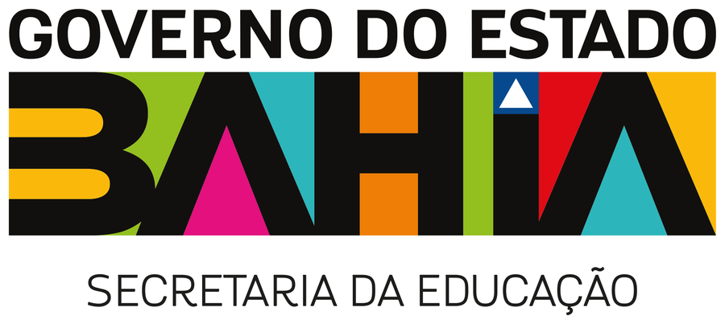

<div align="center">



# 🎓 ENEM 2026 · Enquete de Participação

**Dashboard de acompanhamento da enquete de comparecimento à prova do ENEM 2026**
*Secretaria da Educação do Estado da Bahia*


</div>

---

## 📌 Sobre

Enquete enviada por **WhatsApp** aos estudantes após cada domingo de aplicação da prova —
**"Você compareceu à prova?"** com botões **SIM / NÃO**. Este projeto transforma as
interações recebidas em uma dashboard de acompanhamento com cruzamento automático
com as **bases de alunos** da Secretaria (Pé-de-Meia concluintes e Bolsa Presença,
quando houver telefones), tudo **por número de telefone normalizado**.

> 🗓️ Provas do ENEM 2026: domingos de **08/11** e **15/11/2026** (Inep)

## ✨ Destaques

| | |
|---|---|
| 🖥️ | **Arquivo único e 100% offline** — `dashboard.html` abre com duplo clique, sem servidor, Chart.js embutido |
| 📅 | **Multi-dias nativo** — abas por domingo de prova + visão geral; o 2º domingo já tem seu espaço reservado |
| 🔎 | **Cruzamento por telefone** — identifica quantos alunos das bases responderam e o que declararam, por NTE |
| 📱 | **Mobile first** — KPIs em grade, abas com rolagem horizontal e gráficos empilhados no celular |
| 🔒 | **LGPD-friendly** — só agregados; nenhum nome, CPF ou telefone individual na dashboard ou no repositório |
| 🎨 | **Identidade oficial** — logo da SEC e paleta do Governo do Estado (verde `#8CC63F`, amarelo `#FCB829`) |

## 📊 O que a dashboard mostra

- **KPIs** — interações recebidas, comparecimento declarado (SIM/NÃO com %), pico de respostas por hora e alunos identificados
- **Rosca** SIM × NÃO e **curva horária** de recebimento das respostas (detecta o impacto do disparo)
- **Recortes** por DDD de origem, operadora e UF
- **Cruzamento Pé-de-Meia** — base, telefones válidos, identificados, comparecimento declarado e distribuição por **NTE**
- **Comparativo entre dias de aplicação** — linha por domingo, pronta para a evolução do 2º dia
- Painel de **metodologia e ressalvas** embutido

## 🚀 Como usar

```bash
# 1. Gere/atualize a dashboard a partir das fontes locais
python etl.py

# 2. Abra
dashboard.html   # duplo clique — funciona offline
```

## 🔄 Atualização para o próximo domingo

1. Salve o novo export da plataforma na pasta do projeto (não versionado)
2. Rode `python etl.py` — a associação ao dia de prova é automática:

| Dia | Data da prova | Janela das respostas |
|---|---|---|
| 1º domingo | 08/11/2026 | 08/11 → 14/11 |
| 2º domingo | 15/11/2026 | 15/11 → 21/11 |

3. Reenvie/ republique o `dashboard.html` gerado — ele já nasce com as duas abas

## 🗂 Estrutura

```
├── dashboard.html        👉 produto final — dashboard autocontida (abra este!)
├── data.json             métricas agregadas geradas pelo ETL
├── etl.py                pipeline: lê as fontes, cruza as bases, gera a dashboard
├── template.html         layout editável (dados + Chart.js injetados pelo ETL)
├── chart.umd.min.js      Chart.js 4 embutido no HTML final (offline)
├── logo_sec.png          logo da SEC (recortada do PDF oficial)
├── crop_logo.py          regenera o recorte da logo a partir do PDF oficial
├── logo_sec_2025.pdf     PDF oficial da marca (fonte do recorte)
├── check_dashboard.mjs   validação da dashboard gerada
└── README.md
```

> ⚠️ **As fontes de dados nunca são versionadas** (ver `.gitignore`): export da enquete
> e bases de alunos permanecem apenas na máquina da Secretaria.

## 🔍 Metodologia do cruzamento

- Telefones normalizados para **DDD + 9 dígitos** (remove `55`, `( )`, `-`, zeros; completa o nono dígito em números antigos)
- O cruzamento conta quantos **telefones das bases responderam** e o que **declararam** (SIM/NÃO)
- A base **Bolsa Presença** atual não possui telefones — o pipeline já detecta automaticamente qualquer coluna de telefone (`TEL/FONE/CEL/WHATS`) em versões futuras

## ⚠️ Ressalvas

- A base contém apenas **interações recebidas** (sem contagem de envios) — não é possível calcular *taxa de resposta*
- DDD reflete a **origem do número**; portabilidade e números antigos podem distorcer o recorte geográfico
- Números com resposta repetida são deduplicados no indicador de "números únicos"
- "SIM" é **declaração do contato** (pode ser o próprio aluno ou quem possui o número dele)

## 🧪 Validação

```bash
node check_dashboard.mjs   # sintaxe, Chart.js, execução e dados dos KPIs
```

## 🛠️ Stack

`Python` (pandas · openpyxl · pymupdf · Pillow) · `Chart.js 4` · `HTML/CSS/JS` puro

---

<div align="center">

**Secretaria da Educação do Estado da Bahia** · Governo do Estado da Bahia
*CAB — 5ª Avenida, 550, Centro Administrativo da Bahia, Salvador/BA*

</div>
